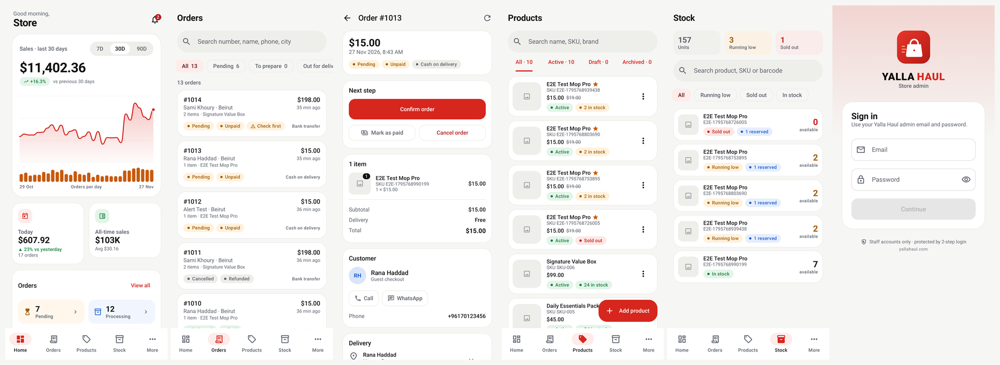
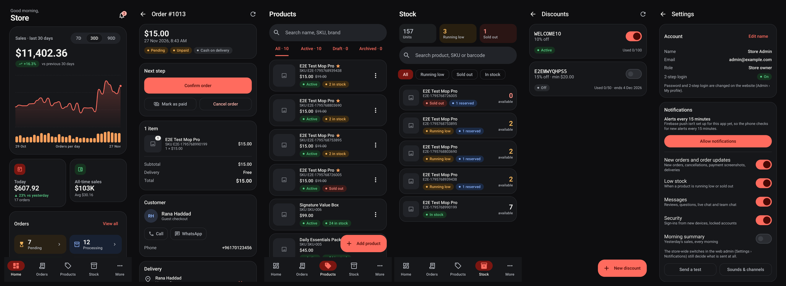
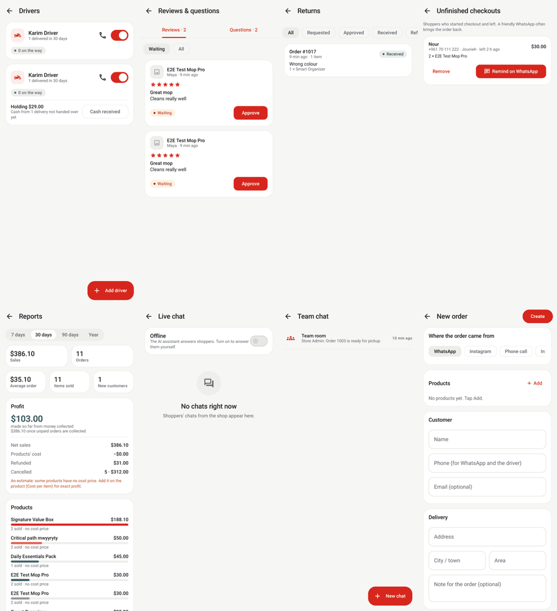

# Yalla Haul Admin — Android app

A native Android app for running the Yalla Haul store from a phone. It talks to the **same
backend, database, products, customers and orders** as the website: every change goes through
the existing `/api/admin/*` endpoints, so stock, refunds, customer emails, WhatsApp messages,
webhooks and the activity log behave exactly as they do in the web admin.





## Features

| Module | What you can do |
|---|---|
| Dashboard | Sales for 7/30/90 days with a touch-to-read chart and orders-per-day bars, change vs the previous period, today vs yesterday, all-time sales and average order, orders by status (donut + shortcuts), payment screenshots and reviews waiting, low stock, best sellers, recent orders |
| Orders | Search (number, name, phone, city), status filters with counts, endless list, risk flags. Order page: next step button (confirm → prepare → out for delivery with tracking → delivered), cancel (with refund warning), mark as paid, items and totals, customer with call/WhatsApp/email, delivery address with map, tracking, payment transactions and transfer screenshots, timeline, staff notes |
| Products | Search, Active/Draft/Archived tabs with counts, stock badges, activate/hide with confirmation, create and edit: photos (gallery upload), name, descriptions, price/compare-at/cost with margin, SKU/barcode, visibility, featured, collections, brand/type/vendor, tags, stock tracking. Options/variants, SEO and formatted descriptions stay on the website and are never overwritten by the app |
| Stock | Units / running low / sold out summary, search by name/SKU/barcode, filters, adjust sheet (+/−, quick adds, exact count, reason, low-stock threshold, recent movements). Can't go below stock reserved for open orders |
| Customers | Search, spend and order counts, profile with contact buttons, addresses and order history |
| Discounts | List with live status, on/off switch, create/edit/delete (percent, amount, free delivery, automatic, minimum, usage limit, first order, once per customer, start/end dates). Product- or collection-scoped, buy-X-get-Y and flash sales keep their scope when edited |
| Alerts | New orders, cancellations, payment screenshots, low stock, reviews/questions/chat, security, morning summary; 30-day history; per-kind switches |
| New orders (v1.1) | Create an order taken on WhatsApp, Instagram or a phone call: pick products and options, customer, delivery address; it goes through the store's normal order rules (stock, totals, emails) |
| WhatsApp confirm (v1.1) | On a pending order: open WhatsApp with the store's confirmation message, then record what the customer said (confirmed, no answer, wrong number, cancelled…) |
| Drivers (v1.1) | Add drivers, give an order to a driver (one or many at once), see who is carrying what and how much cash each driver holds, mark the cash as received |
| Scanning (v1.1) | Scan a barcode with the camera to find a product or change its stock (Google's scanner: no camera permission needed) |
| Product options (v1.1) | Edit the name, SKU, barcode, price and compare-at price of sizes/colours, add or remove options; stock is not touched |
| Bulk actions (v1.1) | Press and hold to select several products (activate, hide, archive) or orders (confirm, give to a driver) |
| Live chat (v1.1) | Go online, see shoppers waiting, read and reply to them |
| Team chat (v1.1) | The team room and direct messages with staff |
| Reviews & questions (v1.1) | Approve or hide reviews, answer and publish product questions |
| Returns & refunds (v1.1) | Record a return on a delivered order, move it through approved/received/refunded; refunds ask for your password first ("confirm it's you"), the same as the website |
| Invoices (v1.1) | Make an invoice or packing slip PDF to share (WhatsApp, email) or print |
| Unfinished checkouts (v1.1) | Shoppers who left during checkout, with a ready WhatsApp reminder |
| Reports (v1.1) | Sales and profit for 7/30/90 days or a year, best products |
| Offline (v1.1) | The last loaded screens stay readable without internet (stored encrypted on the phone), with an "offline" notice |
| Home-screen widget (v1.1) | Today's sales and orders waiting, refreshed every 30 minutes |
| Settings | Account, alert settings + test alert, light/dark/system theme, app lock (fingerprint/face/screen lock), hide content in recents, sign out, sign out everywhere |

Sold-out products stay visible in the shop with a "Sold out" label (the store's existing rule);
the app never hides a product because its stock reached zero.

## Install on the Samsung Galaxy S26

1. Copy the newest `yallahaul-admin-<version>-release.apk` to the phone (or download it from wherever you keep it).
2. Open it from **My Files**. Android asks to allow installing from that app: **Settings → Allow from
   this source**, go back, tap **Install**.
3. Open **Yalla Haul Admin**, sign in with your admin email and password, then the 6-digit code
   from your authenticator app (the same as the website). Staff who never set up 2-step login must
   do it once on the website (`/admin/login`) first.
4. Allow notifications when asked.

Updating: install the newer release APK over the old one (same signing key); you stay signed in.

Requirements: Android 8.0+ (the S26 runs Android 16). The phone needs internet access to the store.

## Sign-in and security

* Same rules as the web admin: staff only, password + 2-step code, shared attempt limits and lockout,
  sign-in from a new phone alerts the owner, sessions last one 12-hour shift, "sign out everywhere"
  ends every session (phones and browsers).
* The session token is encrypted with a key in the Android Keystore, never backed up, and only sent
  to the store's address. Nothing secret is built into the APK.
* HTTPS only. Destructive actions (cancel, mark paid, hide product, delete discount, sign out
  everywhere…) ask for confirmation. Lock-screen notifications hide order details.

## Push notifications (Firebase) — needs your setup

Without Firebase the app still works: it checks the alert history every 15 minutes. For instant
alerts:

1. In the [Firebase console](https://console.firebase.google.com) create a project and add an
   Android app with package `com.yallahaul.admin` (add `com.yallahaul.admin.debug` too for debug builds).
2. Download `google-services.json` into `android-admin/app/` (it is git-ignored) and rebuild.
3. Project settings → Service accounts → **Generate new private key**. Store the whole JSON as a
   Cloudflare Worker secret (never in git):
   ```bash
   npx wrangler secret put FCM_SERVICE_ACCOUNT_JSON   # paste the JSON
   ```
4. Open the app → Settings → Notifications: it shows "Instant alerts"; tap **Send a test**.

The store-wide switches in the web admin (Settings › Notifications) still decide what is sent.

## Build

Requirements: JDK 17+ and the Android SDK (platform 36, build-tools 36). The Gradle wrapper
downloads Gradle 8.14.3.

```bash
cd android-admin
echo "sdk.dir=$ANDROID_HOME" > local.properties
./gradlew assembleDebug          # app/build/outputs/apk/debug/app-debug.apk (installs as "com.yallahaul.admin.debug")
./gradlew assembleRelease        # app/build/outputs/apk/release/app-release.apk (signed if a key is configured)
./gradlew testDebugUnitTest      # unit, server-contract and screenshot tests
./gradlew lintRelease
```

The app talks to `https://yallahaul.com`. For a staging store: `./gradlew assembleDebug
-PyhApiBaseUrl=https://staging.example.com` (HTTPS is required).

Screenshot tests render the real app under Robolectric against recorded store answers and write
PNGs to `app/build/screenshots/`. On networks that block Maven Central, add
`-ProbolectricRepo=https://maven-central.storage-download.googleapis.com/maven2/`.

## Signing

Keep the keystore and its passwords **out of git** (`*.jks`, `keystore.properties` are ignored).

```bash
keytool -genkeypair -v -keystore ~/keys/yallahaul-admin-release.jks -alias yallahaul-admin \
  -keyalg RSA -keysize 4096 -validity 10000
cp keystore.properties.example keystore.properties   # then fill in the path and passwords
./gradlew assembleRelease
```

Or set `YH_KEYSTORE_PATH`, `YH_KEYSTORE_PASSWORD`, `YH_KEY_ALIAS`, `YH_KEY_PASSWORD` in the
environment (e.g. CI secrets). **Back up the keystore**: Android only installs an update signed
with the same key as the installed app.

Before each release bump `versionCode` and `versionName` in `app/build.gradle.kts`.

## Architecture

Kotlin, Jetpack Compose + Material 3, MVVM with repositories, Coroutines/Flow, Hilt, Retrofit +
OkHttp + kotlinx.serialization, DataStore, WorkManager, Coil, Firebase Cloud Messaging, AndroidX
Biometric. Bottom navigation on phones, navigation rail on tablets/unfolded foldables; content is
capped at a readable width.

```
app/src/main/java/com/yallahaul/admin/
  core/model          API models (minor-unit money)
  core/network        ApiService, AuthInterceptor (token only to the store), error mapping
  core/session        SessionManager, Keystore-encrypted TokenVault
  core/data           repositories + payload builders (edits send only what the app edits)
  core/cache          encrypted copies of the last answers for offline reading (cleared on sign-out)
  core/documents      invoice / packing slip PDFs (share and print)
  core/scan           barcode scanner
  widget              home-screen widget (Glance) and its refresh worker
  core/notifications  channels, FCM service, 15-minute fallback worker, registration
  ui/...              one package per screen (screen + ViewModel), shared components and charts
```

Backend pieces added for the app (see `docs/android-admin-audit.md`): `lib/mobile-auth.ts`,
`lib/mobile-devices.ts`, `lib/fcm.ts`, `lib/mobile-orders.ts`, `app/api/mobile/v1/*`, and the bearer
token support in `lib/auth.ts`. v1.1 added `app/api/mobile/v1/{drivers,reviews,questions,unfinished}`,
the WhatsApp/return/refund fields in the order answer, and an `X-Reauth` header for "confirm it's you"
(`lib/reauth.ts`; the website's cookie is unchanged). End-to-end check against a local copy of the store:
`scripts/mobile-api-e2e.ts` (refuses to run against the live store).
